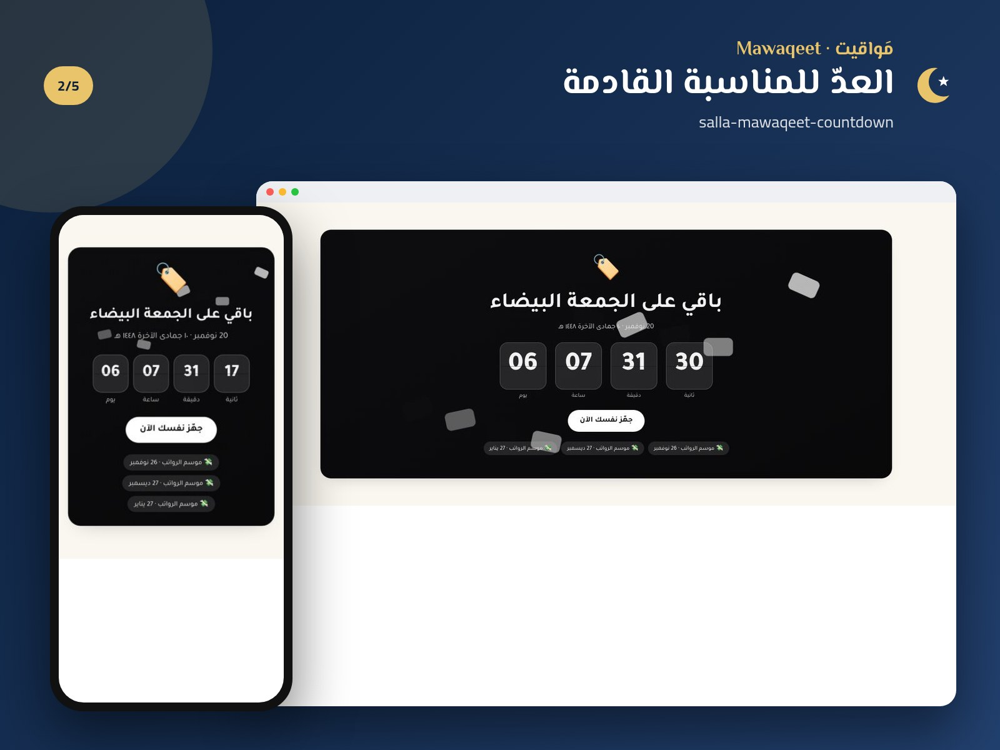
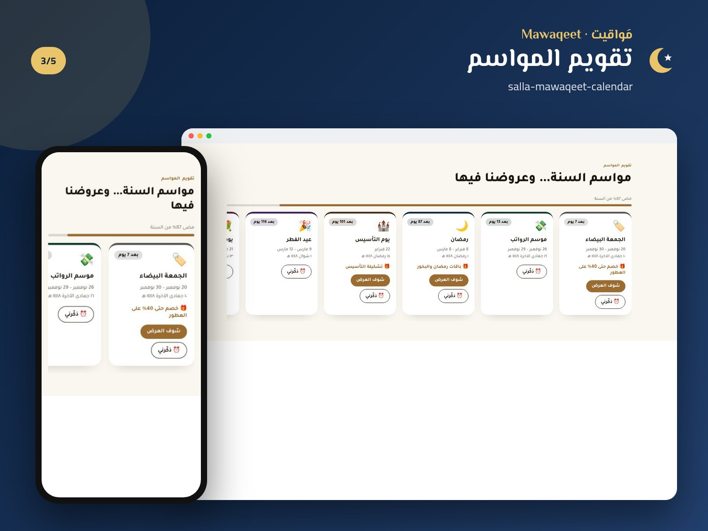
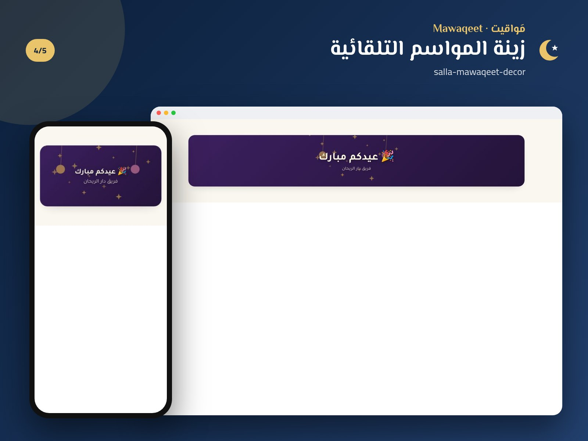

# مَواقيت — محرك المواسم السعودية التلقائي
**Mawaqeet — Automatic Saudi Seasons Engine** — Twilight Component Bundle لمتاجر سلة (ثيم رائد وأي ثيم يدعم Twilight).

5 عناصر تدير مواسم متجرك وحدها: تكتشف رمضان والعيدين وعشر ذي الحجة واليوم الوطني ويوم التأسيس والجمعة البيضاء والرواتب من تقويم أم القرى تلقائياً كل سنة، وتغيّر الألوان والزينة والنصوص قبل الموسم وأثناءه وفي آخره، مع عدّاد للمناسبة القادمة، تقويم سنوي بتذكير في الجوال، زينة تلقائية، وموسم الرواتب.

5 components that run your seasons by themselves: Ramadan, both Eids, Dhul-Hijjah, National Day, Founding Day, White Friday and paydays are detected from the Umm al-Qura calendar every year, switching colours, decorations and copy before, during and at the end of each season; plus a next-occasion countdown, a yearly calendar with phone reminders, auto decorations and a payday engine.

| العنصر | الوظيفة | عدد الإعدادات |
|---|---|---|
| `salla-mawaqeet-hero` | واجهة الموسم التلقائية | 91 |
| `salla-mawaqeet-countdown` | العدّ للمناسبة القادمة | 70 |
| `salla-mawaqeet-calendar` | تقويم المواسم | 66 |
| `salla-mawaqeet-decor` | زينة المواسم التلقائية | 66 |
| `salla-mawaqeet-payday` | موسم الرواتب | 55 |

**مجموع الإعدادات: 348** — تشمل لكل عنصر 30 إعداد تصميم موحد (السمة، الألوان، الخط، المسافات، الحركة، الجدولة، الإخفاء حسب الجهاز، مساعد الإعداد داخل المحرر).

## ذكاء العناصر
- **للتاجر:** إذا تُركت المنتجات فارغة يختار العنصر تلقائياً من بيانات متجرك (الأكثر مبيعاً، الأحدث، العروض…) ويكتب نصوصاً جاهزة بالعربية والإنجليزية، مع مساعد إعداد يظهر داخل المحرر فقط.
- **للعميل:** ذاكرة على جهاز العميل فقط (localStorage) لما شاهده وأضافه، لترتيب الاقتراحات — بدون أي بيانات شخصية تُرسل.
- **بدون أرقام مزيفة:** المخزون والمبيعات والتقييمات والخصومات وتواريخ انتهاء العروض تُقرأ من بيانات سلة الحقيقية فقط، وما لا يتوفر لا يُعرض.

## التطوير
```bash
pnpm install
pnpm run build        # vite build — dist/<component>.js
pnpm run build:split  # كل عنصر في ملف مستقل
```
المعاينة المحلية بالبيانات التجريبية: `demo/index.html` (بيانات عينة فقط).

## صور






